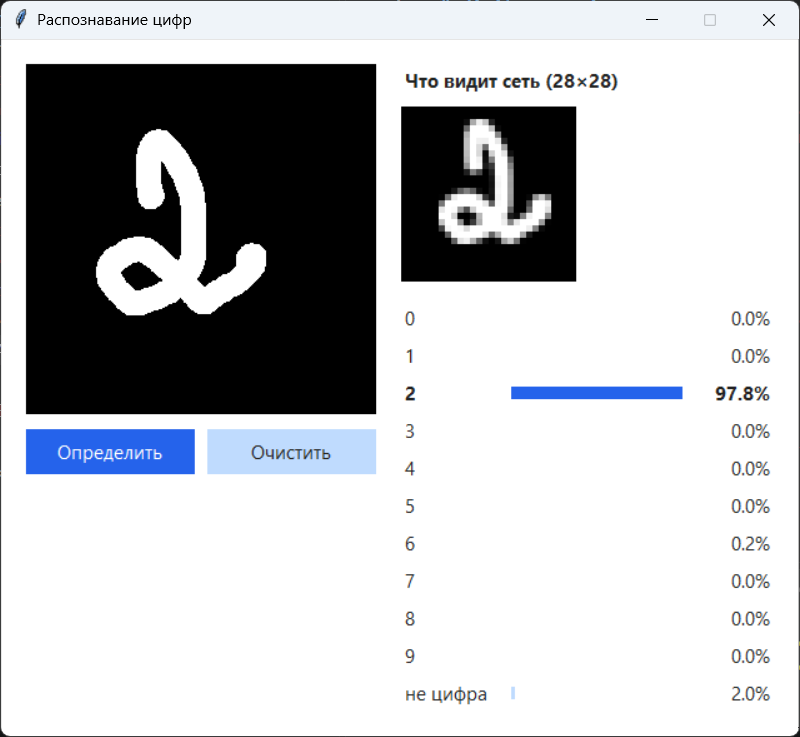
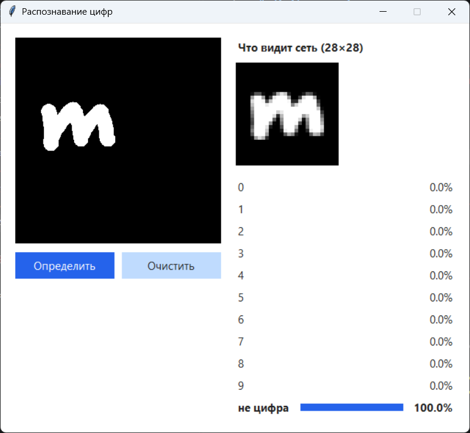

# digit-recognizer

Нейросеть на NumPy для рукописных цифр (MNIST) с классом «не цифра» и окном для рисования мышью.

- Только NumPy, обучение на CPU, без GPU
- Forward, backprop и SGD написаны вручную; градиент сверяется с численным
- 17 автоматических проверок

Архитектура: `784 → 128 (ReLU) → 11 (softmax)`, классы: цифры 0–9 и «не цифра».






## Установка

Нужен Python 3.8+ и tkinter (для окна).

```bash
# Linux (Debian/Ubuntu/Mint)
sudo apt install python3-venv python3-tk
python3 -m venv .venv && source .venv/bin/activate
pip install -r requirements.txt
```

```bash
# macOS (Python с python.org или `brew install python-tk`)
python3 -m venv .venv && source .venv/bin/activate
pip install -r requirements.txt
```

```bat
:: Windows (Python с python.org, tkinter в комплекте)
py -m venv .venv
.venv\Scripts\activate
pip install -r requirements.txt
```

Проверено на Linux. На Windows и macOS не запускалось.

## Запуск

```bash
python check.py     # проверки (ничего не скачивает)
python train.py     # скачивает MNIST, обучает, сохраняет model.npz
python app.py       # окно для рисования
```

Быстрая проба без полного обучения: `python train.py --samples 5000 --epochs 3`

### Параметры `train.py`

| Параметр | По умолчанию | Описание |
|---|---|---|
| `--epochs` | 10 | число эпох |
| `--lr` | 0.1 | learning rate |
| `--hidden` | 128 | нейронов в скрытом слое |
| `--batch-size` | 64 | размер порции |
| `--samples` | все 50 000 | брать только первые N цифр |
| `--unknown` | 10% от числа цифр | число сгенерированных «не цифр» (0 — без них) |

Данные: 50 000 train / 10 000 val / 10 000 test. В конце `train.py` печатает accuracy на test для цифр, то же с порогом уверенности 0.7 и долю узнанных «не цифр». Конфигурация по умолчанию обычно даёт около 97–98% на цифрах.

## Окно

Рисуй белым на чёрном поле. **Enter** — определить, **Esc** — очистить. Справа: превью 28×28 (вход сети) и вероятности 11 классов; самый вероятный выделен синим.

## Структура

```
data.py         загрузка и проверка MNIST
network.py      сеть: forward, backward, step, save/load, decide
preprocess.py   кисть и приведение рисунка к виду MNIST
unknown.py      генератор примеров «не цифра»
train.py        обучение и отчёт
app.py          окно (tkinter)
check.py        проверки
THEORY.md       теория и разбор проекта
```

Создаются при работе: `data/mnist.npz`, `model.npz`.

## Проверки

`python check.py` — 17 проверок: softmax, формы, backprop против численного градиента, способность сети учиться, сохранение/загрузка, предобработка рисунка, генератор «не цифр», сборка обучающего набора, окно (пропускается без tkinter и экрана). Код возврата 1 при ошибке.

## Если не работает

| Проблема | Решение |
|---|---|
| `externally-managed-environment` | включи окружение: `source .venv/bin/activate` |
| `No module named 'numpy'` | окружение не включено или не выполнен `pip install -r requirements.txt` |
| `No module named 'tkinter'` | Linux: `sudo apt install python3-tk`; macOS: `brew install python-tk` или Python с python.org |
| Не скачивается MNIST | положи `mnist.npz` в `data/` вручную (адреса в `data.URLS`) |
| `CERTIFICATE_VERIFY_FAILED` (macOS) | запусти `Install Certificates.command` из папки Python |
| «Модель не найдена» или «старого формата» | `python train.py` |
| `TclError ... display` | нужна графическая сессия (не SSH) |
| loss `nan`, «почти не обучилась» | `--lr 0.05` |

## Документация

[THEORY.md](THEORY.md): математика (forward, softmax, cross-entropy, backprop с выводом и примером на числах), оптимизация, метрики, предобработка, класс «не цифра», разбор каждого файла, вопросы для собеседования.
